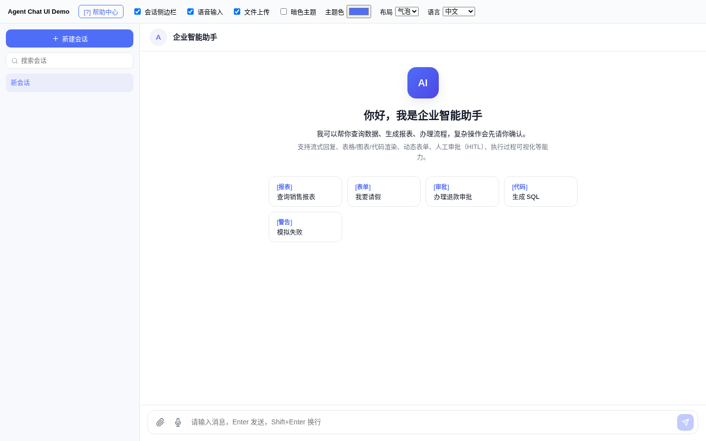
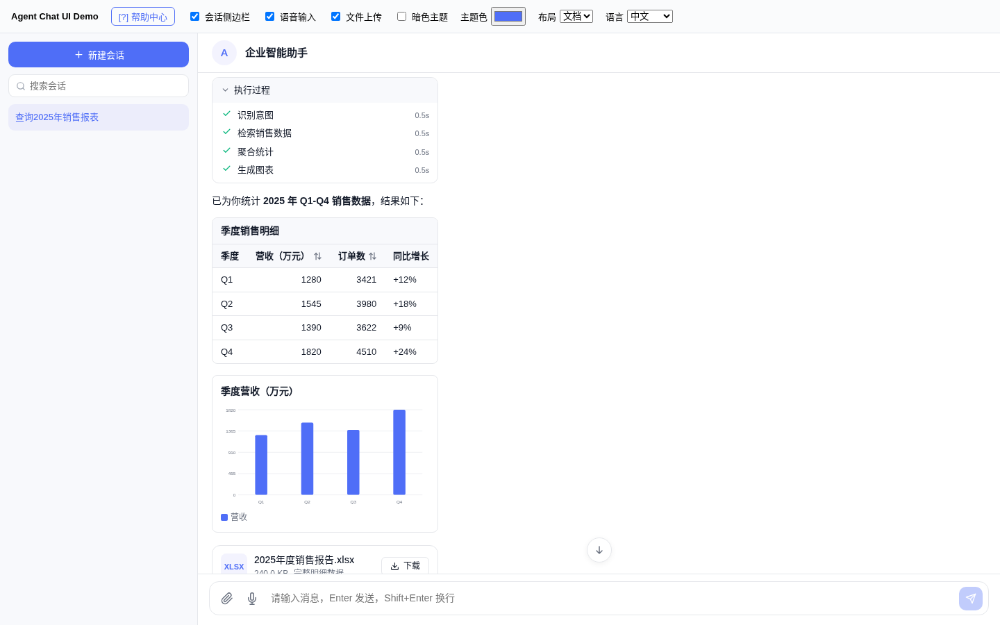
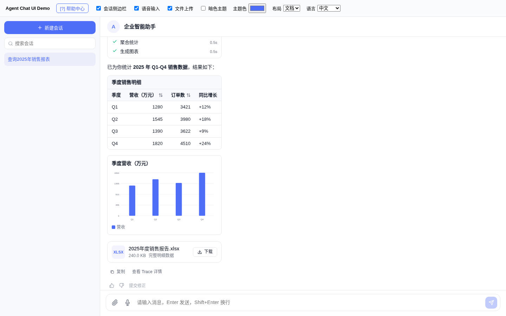
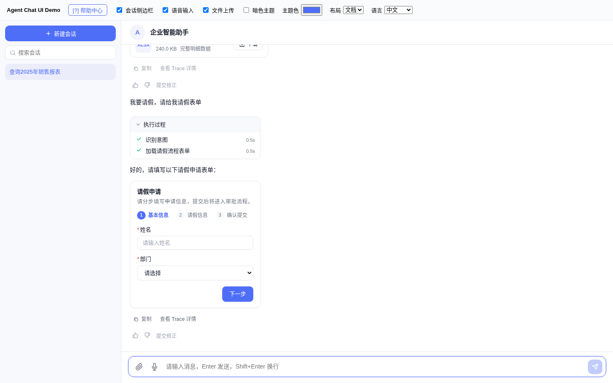
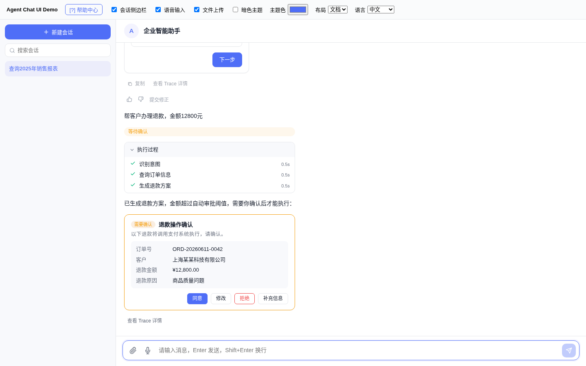
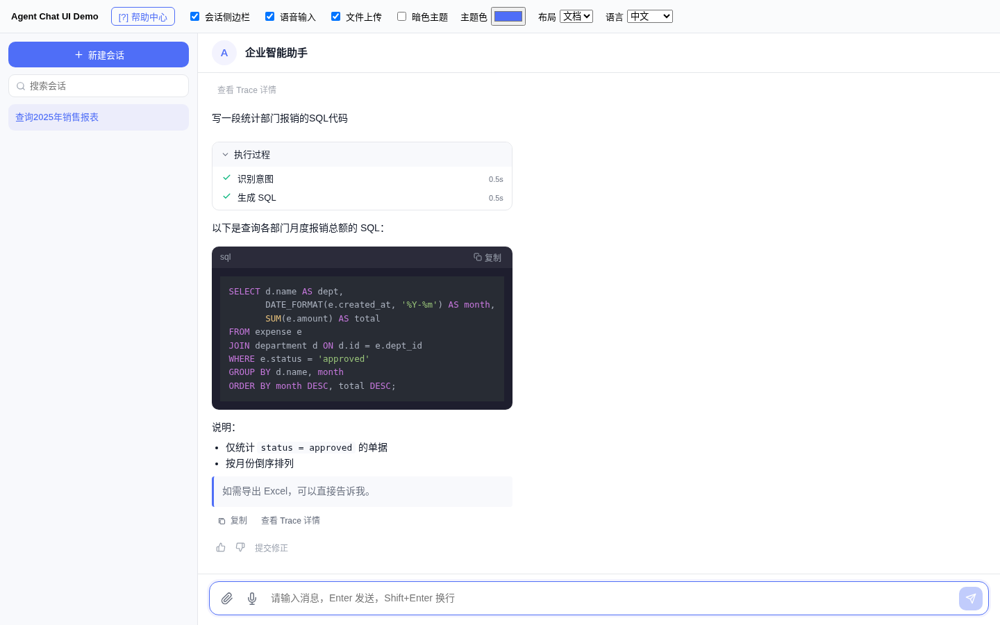
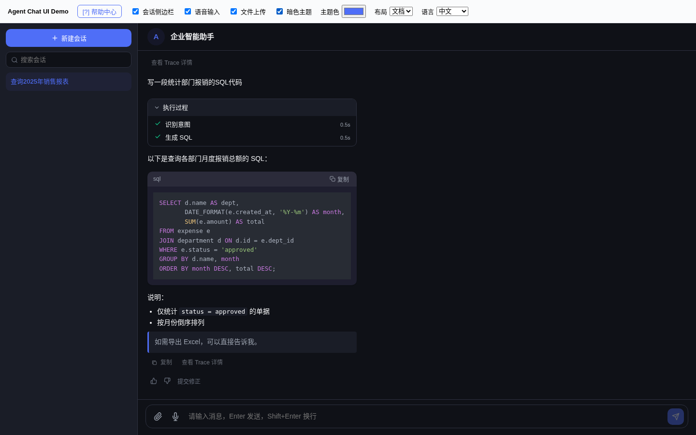
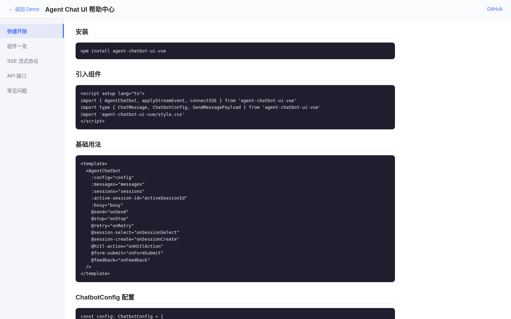

# ChatUI · Agent Chat UI for Vue 3

**English** | [简体中文](README.zh-CN.md)

A generic **Vue 3 component library for AI-agent chatbots** (npm package name `agent-chatbot-ui-vue`). A single `<AgentChatbot>` component gives you a session sidebar, streaming replies, rich content blocks (Markdown, code, tables, charts, files), dynamic forms, human-in-the-loop (HITL) approval cards, execution-step visualization and feedback. Every sub-component is also exported. The repo ships a demo app backed by a mock agent, so you can try everything without a backend.

## Features

- **`AgentChatbot` all-in-one component**: session list (create / rename / delete / search), welcome block with quick actions, message list, input box, stop / retry.
- **Streaming protocol**: `applyStreamEvent()` applies `status` / `delta` / `block` / `step` / `error` / `done` events to a message; `connectSSE()` is a fetch-based SSE client (POST + `AbortSignal`) that parses `data: {...}` events.
- **Message status**: `pending`, `thinking`, `running`, `streaming`, `waiting_hitl`, `completed`, `failed`, `canceled`, with status badges and a typing indicator.
- **Content blocks**: `text`, `markdown` (marked + highlight.js), `code` (with copy), `table` (sortable columns), `chart` (bar / line / pie), `file` (download card), `form`, `hitl`, `steps`.
- **Dynamic forms**: single- or multi-step forms from a schema; widgets `input`, `textarea`, `number`, `select`, `radio`, `checkbox`, `switch`, `date`, with required / pattern / min / max validation.
- **HITL approval cards**: `approve`, `reject`, `modify` (editable fields) and `supplement` actions.
- **Execution steps**: collapsible step list with status and duration, plus a "view trace" event.
- **Feedback**: like / dislike, correction text, copy message.
- **Input**: text, voice (start/stop events), file and image attachments, each switchable.
- **Theming**: bubble or document layout, dark mode, primary color, avatar shape / size, bubble radius, font size, sidebar width, max message width, background image and more (`ChatbotTheme`).
- **i18n**: built-in `zh-CN` and `en-US` locales.
- **Demo help center**: quick start, component list, SSE protocol, API and FAQ pages.

## Screenshots

All screenshots are from the demo (`demo/`) running locally against the bundled mock agent (`demo/mockAgent.ts`), captured with headless Chromium. Except for the welcome screen, they use the demo's "document" layout.

| Welcome & quick actions | Execution steps + table |
| --- | --- |
|  |  |
| **Chart + file card** | **Dynamic form (multi-step)** |
|  |  |
| **HITL approval card** | **Code block** |
|  |  |
| **Dark theme** | **Help center** |
|  |  |

## Tech stack

- Vue 3 (peer dependency `vue ^3.3.0`) + TypeScript
- Vite 5 (library mode, outputs ES + UMD) and `@vitejs/plugin-vue`
- [marked](https://marked.js.org) for Markdown, [highlight.js](https://highlightjs.org) for code highlighting
- Charts are rendered by the library itself (no chart dependency)

## Quick start

Requires Node.js 20 (the version used in CI).

```bash
git clone https://github.com/gatesenman/chatui.git
cd chatui
npm ci

# Run the demo with hot reload
npm run dev                                # http://localhost:5173/

# Build the demo as a static site into dist-demo/ (what the GitHub Pages workflow runs)
npm run build:demo

# Build the library into dist/
npm run build

# Type check
npm run typecheck
```

### Using the components

```vue
<script setup lang="ts">
import { reactive } from 'vue'
import { AgentChatbot, applyStreamEvent, connectSSE, type ChatMessage, type ChatbotConfig } from 'agent-chatbot-ui-vue'

const config: ChatbotConfig = {
  welcomeTitle: 'Hi, I am your assistant',
  quickActions: [{ id: 'q1', label: 'Sales report', prompt: 'Show the 2025 sales report' }],
  input: { text: true, file: true },
  theme: { title: 'Assistant', layout: 'bubble' },
  locale: 'en-US'
}
const messages = reactive<ChatMessage[]>([])

async function onSend({ text }: { text: string }) {
  messages.push({ id: crypto.randomUUID(), role: 'user', status: 'completed', blocks: [{ type: 'text', text }], createdAt: Date.now() })
  const id = crypto.randomUUID()
  messages.push({ id, role: 'assistant', status: 'pending', blocks: [], createdAt: Date.now() })
  // your backend streams `data: {"type":"delta","messageId":"<id>","text":"..."}` events
  await connectSSE({ url: '/api/chat', body: { text, messageId: id }, onEvent: (e) => applyStreamEvent(messages, e) })
}
</script>

<template>
  <AgentChatbot :config="config" :messages="messages" @send="onSend" />
</template>
```

You can also register everything globally with `app.use(AgentChatUI)` (default export).

**`AgentChatbot` props**: `config` (`ChatbotConfig`), `messages`, `sessions`, `activeSessionId`, `busy`.
**Events**: `send`, `stop`, `retry`, `session-select`, `session-create`, `session-remove`, `session-rename`, `hitl-action`, `form-submit`, `feedback`, `correction`, `open-trace`, `file-download`, `voice-start`, `voice-stop`.

## Project structure

```
.
├── src/
│   ├── index.ts                 # exports + Vue plugin (AgentChatUI)
│   ├── types.ts                 # messages, content blocks, config, stream events
│   ├── i18n.ts                  # zh-CN / en-US
│   ├── composables/useStreamEvents.ts   # applyStreamEvent / connectSSE
│   ├── styles/index.css
│   └── components/
│       ├── AgentChatbot.vue  SessionSidebar.vue  WelcomeBlock.vue
│       ├── MessageItem.vue  MessageInput.vue  MessageStatusBadge.vue  FeedbackBar.vue
│       ├── renderers/   Markdown / CodeBlock / Table / Chart / FileCard
│       ├── forms/       DynamicForm / FormFields
│       ├── hitl/        ApprovalCard
│       └── run/         ExecutionSteps
├── demo/                        # demo app, mock agent, help center
├── vite.config.ts               # library build; `--mode demo` builds the demo
└── .github/workflows/deploy.yml # builds the demo and deploys it to GitHub Pages on push to main
```

## Configuration

Everything is configured through the `config` prop (`ChatbotConfig` in `src/types.ts`): welcome text, quick actions, input capabilities, theme, `showSessions`, `allowStop`, `enableFeedback`, `inputPlaceholder`, `locale`, `timestampFormat`, `enableCopyMessage`, `messageGroupInterval`, `autoScrollStrategy` (`always` / `smart` / `never`), `showTypingIndicator`, `showScrollToBottom`, empty-state text and `className` injection.

## Known issues

- The package is not published to npm yet.

`npm run build` now emits `dist/agent-chat-ui.{js,umd.cjs,css}` plus `dist/index.d.ts` (and per-component `.d.ts`), matching the `exports` map; `vue`, `marked` and `highlight.js` are no longer bundled into the library. `npm run dev` starts the demo directly, and rich messages in the bubble layout use the full message width.

## Contributing

Issues and pull requests are welcome. Please run `npm run typecheck` and `npm run build` before opening a PR.

## License

`package.json` declares **MIT**, but the repository does not contain a LICENSE file yet.
