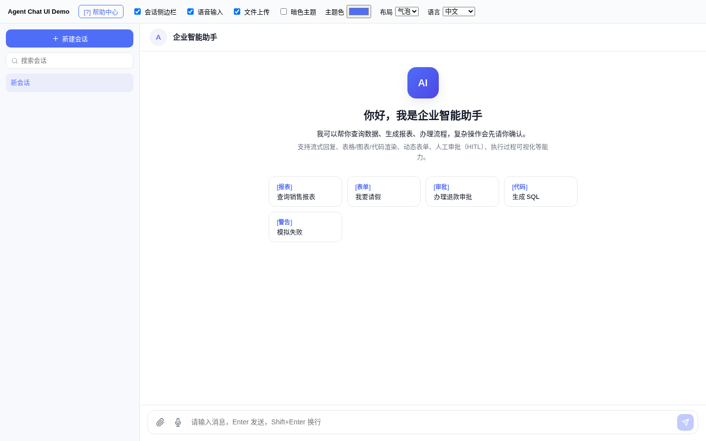
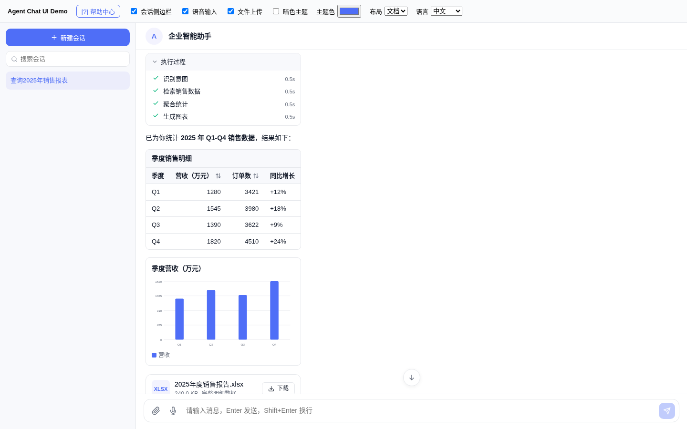
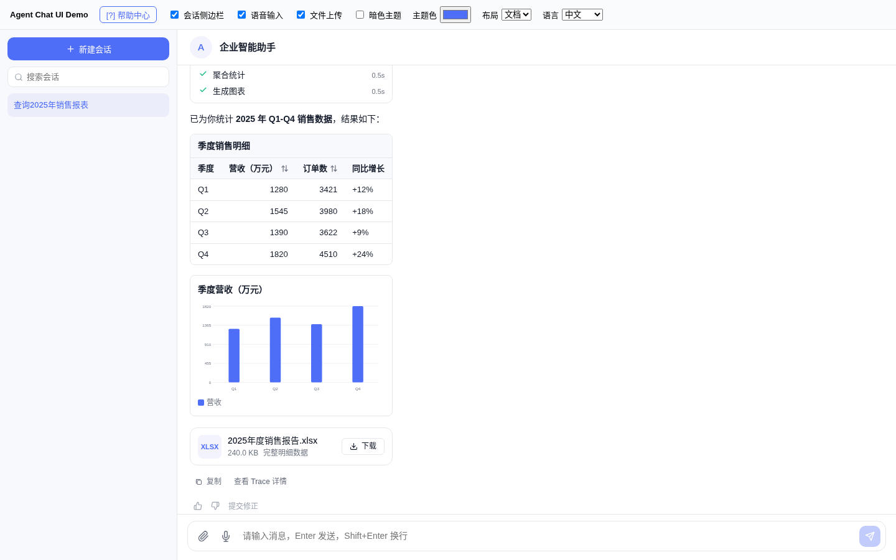
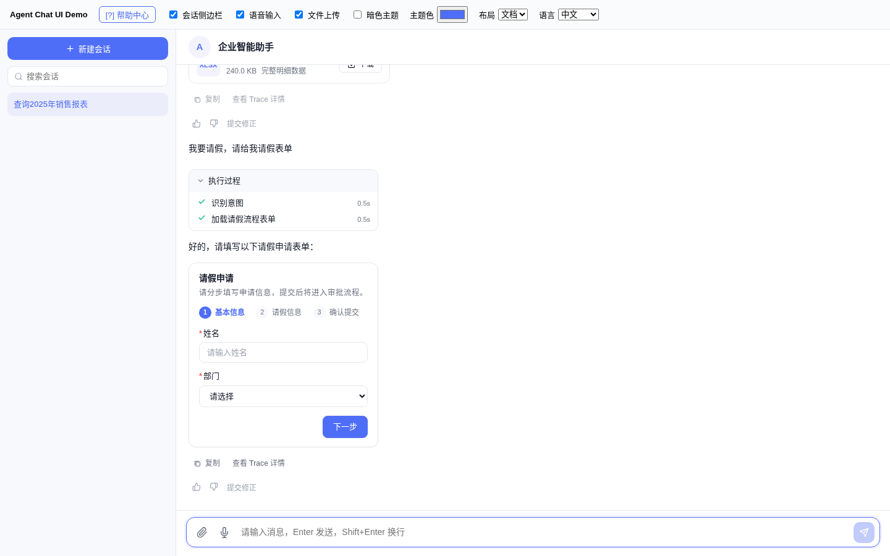
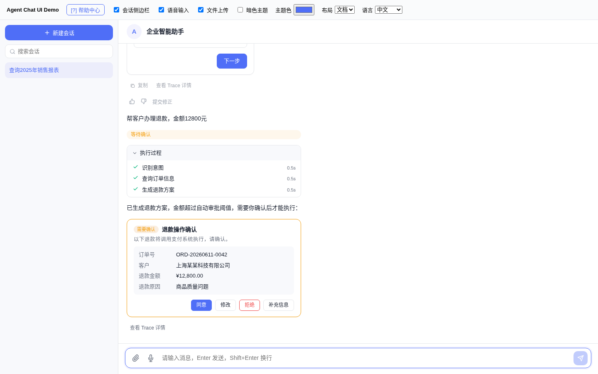
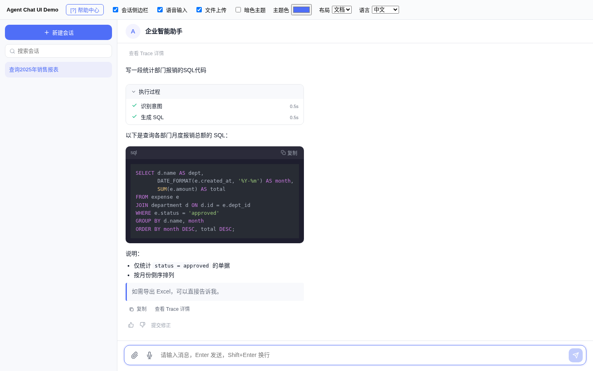
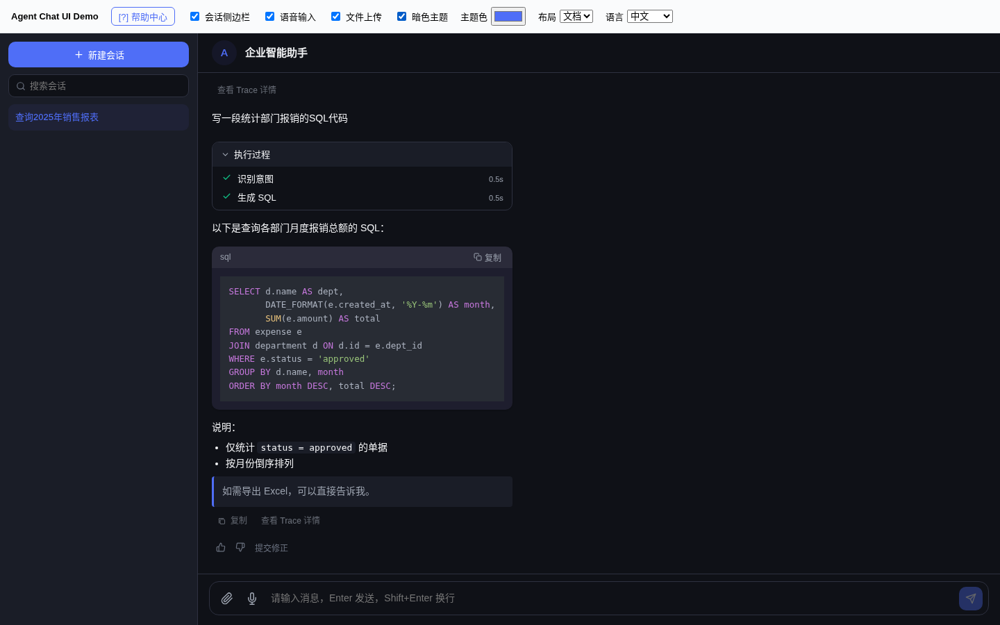
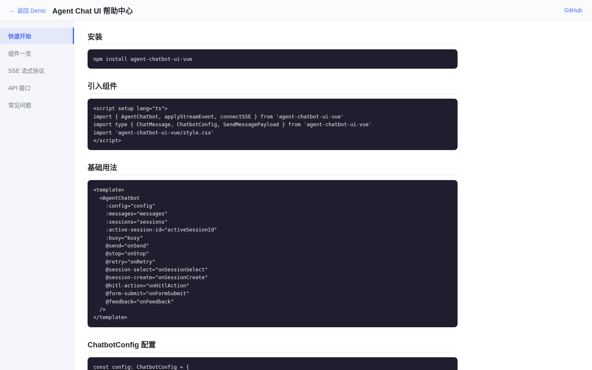

# ChatUI · Vue 3 Agent 聊天组件库

[English](README.md) | **简体中文**

一个通用的 **Vue 3 AI Agent 聊天机器人组件库**（npm 包名 `agent-chatbot-ui-vue`）。一个 `<AgentChatbot>` 组件即可获得会话侧栏、流式回复、富内容块（Markdown、代码、表格、图表、文件）、动态表单、人工确认（HITL）卡片、执行过程可视化和反馈能力；所有子组件也都单独导出。仓库自带一个基于 Mock Agent 的 Demo，无需后端即可体验全部功能。

## 功能

- **`AgentChatbot` 一体化组件**：会话列表（新建 / 重命名 / 删除 / 搜索）、欢迎区与快捷指令、消息列表、输入框、停止 / 重试。
- **流式协议**：`applyStreamEvent()` 把 `status` / `delta` / `block` / `step` / `error` / `done` 事件应用到消息上；`connectSSE()` 是基于 fetch 的 SSE 客户端（支持 POST 与 `AbortSignal` 中断），解析 `data: {...}` 格式事件。
- **消息状态**：`pending`、`thinking`、`running`、`streaming`、`waiting_hitl`、`completed`、`failed`、`canceled`，带状态徽标与打字指示器。
- **内容块**：`text`、`markdown`（marked + highlight.js）、`code`（可复制）、`table`（列可排序）、`chart`（柱状 / 折线 / 饼图）、`file`（下载卡片）、`form`、`hitl`、`steps`。
- **动态表单**：按 Schema 渲染单步 / 多步表单，控件包括 `input`、`textarea`、`number`、`select`、`radio`、`checkbox`、`switch`、`date`，支持必填 / 正则 / 最小最大值校验。
- **HITL 审批卡片**：`approve` 同意、`reject` 拒绝、`modify` 修改（可编辑字段）、`supplement` 补充信息。
- **执行步骤**：可折叠的步骤列表，显示状态与耗时，并提供「查看 Trace」事件。
- **反馈**：点赞 / 点踩、提交修正、复制整条消息。
- **输入**：文本、语音（开始 / 结束事件）、文件与图片附件，均可开关。
- **主题**：气泡 / 文档两种布局、暗色模式、主题色、头像形状与尺寸、气泡圆角、字号、侧栏宽度、消息最大宽度、背景图等（`ChatbotTheme`）。
- **国际化**：内置 `zh-CN`、`en-US`。
- **Demo 帮助中心**：快速开始、组件一览、SSE 流式协议、API 接口、常见问题。

## 截图

以下截图均来自本地运行的 Demo（`demo/`），数据由仓库内的 Mock Agent（`demo/mockAgent.ts`）生成，由无头 Chromium 实拍。除欢迎页外，其余截图使用 Demo 中的「文档」布局。

| 欢迎页与快捷指令 | 执行过程 + 表格 |
| --- | --- |
|  |  |
| **图表 + 文件卡片** | **动态表单（多步）** |
|  |  |
| **HITL 人工审批卡片** | **代码块** |
|  |  |
| **暗色主题** | **帮助中心** |
|  |  |

## 技术栈

- Vue 3（peer 依赖 `vue ^3.3.0`）+ TypeScript
- Vite 5（库模式，输出 ES + UMD）+ `@vitejs/plugin-vue`
- [marked](https://marked.js.org) 渲染 Markdown，[highlight.js](https://highlightjs.org) 代码高亮
- 图表由组件自行绘制，无额外图表依赖

## 快速开始

需要 Node.js 20（CI 使用的版本）。

```bash
git clone https://github.com/gatesenman/chatui.git
cd chatui
npm ci

# 启动 Demo（热更新）
# 注意：`npm run dev`（即 `vite demo`）不会读取根目录的 vite.config.ts，
# 会报 `@agent/chat-ui` 无法解析，需显式指定配置：
npx vite demo --config vite.config.ts      # http://localhost:5173/

# 构建 Demo 静态站点到 dist-demo/（GitHub Pages 工作流使用的命令）
npm run build:demo

# 构建组件库到 dist/
npm run build

# 类型检查
npm run typecheck
```

### 使用组件

```vue
<script setup lang="ts">
import { reactive } from 'vue'
import { AgentChatbot, applyStreamEvent, connectSSE, type ChatMessage, type ChatbotConfig } from 'agent-chatbot-ui-vue'

const config: ChatbotConfig = {
  welcomeTitle: '你好，我是智能助手',
  quickActions: [{ id: 'q1', label: '查询销售报表', prompt: '查询2025年销售报表' }],
  input: { text: true, file: true },
  theme: { title: '智能助手', layout: 'bubble' },
  locale: 'zh-CN'
}
const messages = reactive<ChatMessage[]>([])

async function onSend({ text }: { text: string }) {
  messages.push({ id: crypto.randomUUID(), role: 'user', status: 'completed', blocks: [{ type: 'text', text }], createdAt: Date.now() })
  const id = crypto.randomUUID()
  messages.push({ id, role: 'assistant', status: 'pending', blocks: [], createdAt: Date.now() })
  // 后端以 `data: {"type":"delta","messageId":"<id>","text":"..."}` 推送事件
  await connectSSE({ url: '/api/chat', body: { text, messageId: id }, onEvent: (e) => applyStreamEvent(messages, e) })
}
</script>

<template>
  <AgentChatbot :config="config" :messages="messages" @send="onSend" />
</template>
```

也可以 `app.use(AgentChatUI)`（默认导出）全局注册所有组件。

**`AgentChatbot` 属性**：`config`（`ChatbotConfig`）、`messages`、`sessions`、`activeSessionId`、`busy`。
**事件**：`send`、`stop`、`retry`、`session-select`、`session-create`、`session-remove`、`session-rename`、`hitl-action`、`form-submit`、`feedback`、`correction`、`open-trace`、`file-download`、`voice-start`、`voice-stop`。

## 项目结构

```
.
├── src/
│   ├── index.ts                 # 导出 + Vue 插件（AgentChatUI）
│   ├── types.ts                 # 消息、内容块、配置、流式事件类型
│   ├── i18n.ts                  # zh-CN / en-US
│   ├── composables/useStreamEvents.ts   # applyStreamEvent / connectSSE
│   ├── styles/index.css
│   └── components/
│       ├── AgentChatbot.vue  SessionSidebar.vue  WelcomeBlock.vue
│       ├── MessageItem.vue  MessageInput.vue  MessageStatusBadge.vue  FeedbackBar.vue
│       ├── renderers/   Markdown / CodeBlock / Table / Chart / FileCard
│       ├── forms/       DynamicForm / FormFields
│       ├── hitl/        ApprovalCard
│       └── run/         ExecutionSteps
├── demo/                        # Demo 应用、Mock Agent、帮助中心
├── vite.config.ts               # 库构建；`--mode demo` 构建 Demo
└── .github/workflows/deploy.yml # push 到 main 时构建 Demo 并部署到 GitHub Pages
```

## 配置

全部通过 `config` 属性配置（见 `src/types.ts` 中的 `ChatbotConfig`）：欢迎文案、快捷指令、输入能力、主题、`showSessions`、`allowStop`、`enableFeedback`、`inputPlaceholder`、`locale`、`timestampFormat`、`enableCopyMessage`、`messageGroupInterval`、`autoScrollStrategy`（`always` / `smart` / `never`）、`showTypingIndicator`、`showScrollToBottom`、空状态文案以及 `className` 注入。

## 已知问题

- `npm run dev` 会报 `@agent/chat-ui` 无法解析：`vite demo` 会去 `demo/` 目录下找配置文件。请改用 `npx vite demo --config vite.config.ts`（见快速开始）。
- **气泡布局**下，包含富内容块（执行步骤、表格、图表）的助手消息在 Demo 中会被压缩成很窄的一列；文档布局显示正常。
- `package.json` 中 `types` 指向 `dist/index.d.ts`、`./style.css` 指向 `dist/agent-chat-ui.css`，但目前 `npm run build` 产出的是 `dist/style.css`，且不生成 `.d.ts`。
- 该包尚未发布到 npm；`package.json` 的 `repository` 仍指向 `gaosichun888/chatui`。

## 参与贡献

欢迎提 Issue 或 Pull Request。提交前请先运行 `npm run typecheck` 和 `npm run build`。

## 许可证

`package.json` 中声明为 **MIT**，但仓库暂未包含 LICENSE 文件。
